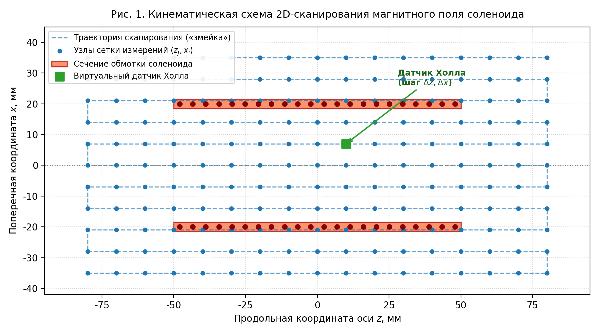
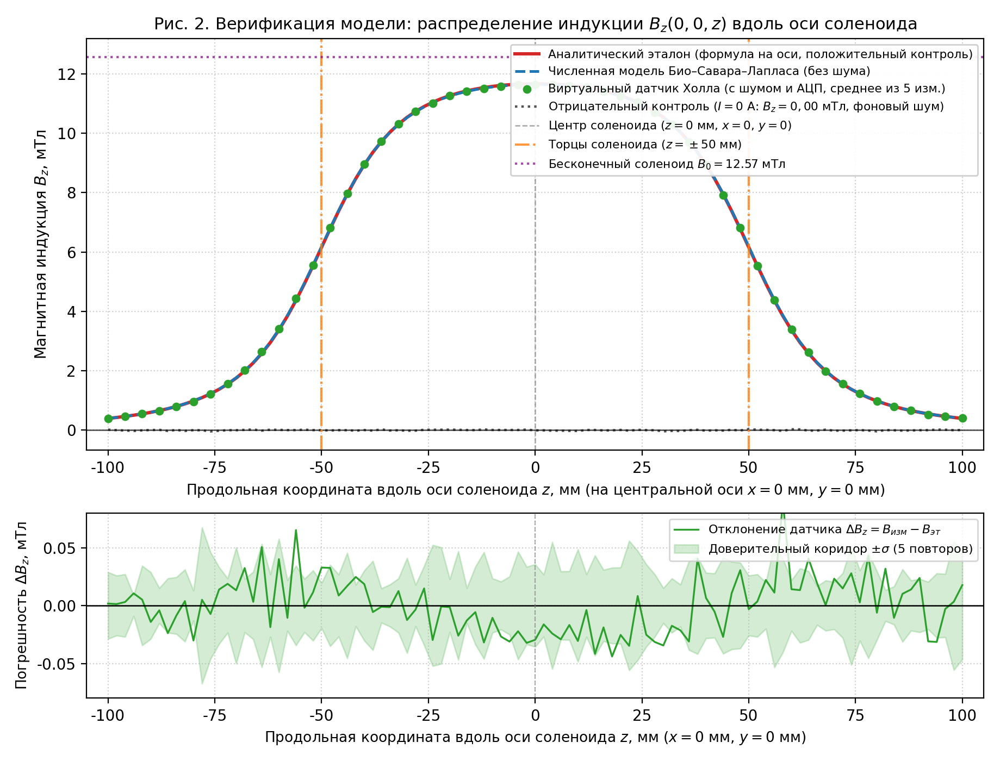
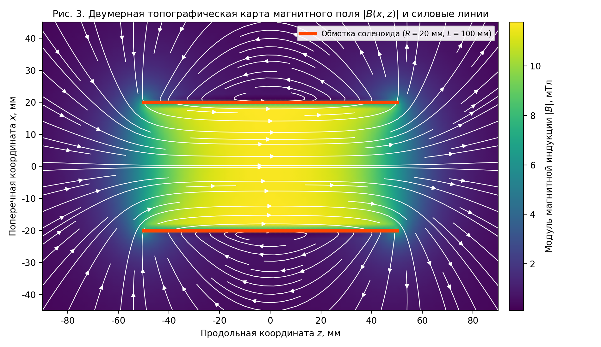
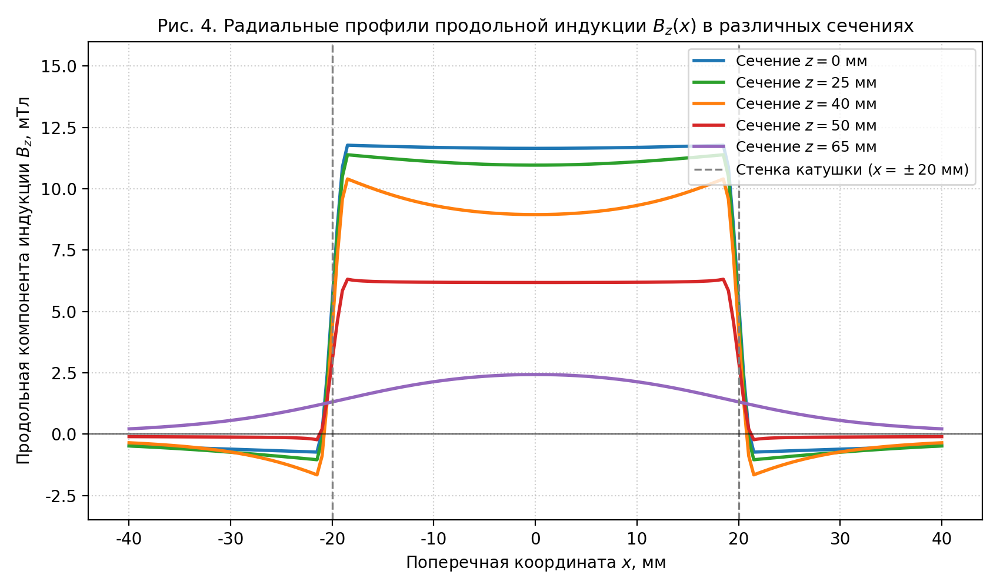
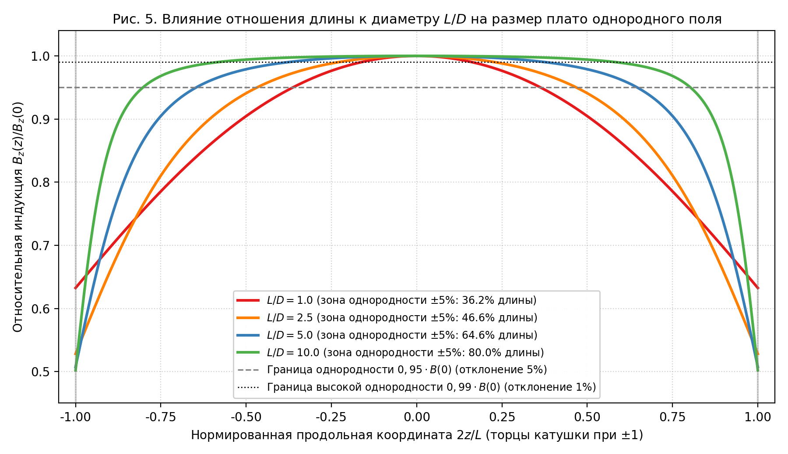

# Разработка автоматизированного устройства для измерения распределения магнитного поля соленоидов

**Цифровой двойник двухкоординатного (2D) сканирующего магнитометра на основе закона Био — Савара — Лапласа и стохастической модели датчика Холла**

* **Автор проекта:** Лукьянов Кирилл Алексеевич (10 класс, МОУ “Сланцевская СОШ №1”, Ленинградская область)
* **Научный руководитель:** Заборская Ольга Владимировна, учитель физики
* **Мероприятие:** Региональный этап Всероссийского конкурса научно-исследовательских работ им. Д. И. Менделеева (2026 г.), Конференция «Практика – критерий истины», Секция № 1
* **Направление:** Передовые производственные технологии (Цифровые двойники, электромагнетизм, 2D-магнитометрия)

---

## О проекте

Программный комплекс моделирует работу автоматизированного координатного стенда, который перемещает виртуальный датчик Холла (**Honeywell SS49E**) с 14-битным АЦП по двумерной сетке «змейкой» в меридиональном сечении цилиндрического соленоида и строит высокоточную карту распределения магнитной индукции $\vec{B}(x, 0, z)$.

### Ключевые инженерные и исследовательские результаты:
* **Высокая точность (контрольный эксперимент):** среднеквадратичная погрешность виртуального датчика с учетом теплового шума ($\sigma = 0,035\text{ мТл}$), квантования АЦП ($0,01\text{ мТл}$) и микроошибки привода ($50\text{ мкм}$) при 5-кратном усреднении составила **$0,208\%$** ($\text{RMSE} = 0,0243\text{ мТл}$) относительно аналитического эталона на оси.
* **Быстродействие (векторизация NumPy):** двумерная карта поля из **$5\,551$ узла** ($27\,755$ отсчетов датчика, $333\text{ млн}$ векторных операций по $500$ виткам) рассчитывается за **$2,5\text{ секунды}$** (ускорение в $85$ раз).
* **Доказательство гипотезы по однородности поля:** при отношении длины катушки к диаметру **$L/D \ge 5$** протяженность центральной зоны однородного поля (с допуском $\pm 5\%$) достигает **$64,6\%$ длины соленоида** (при $L/D = 10$ — $80,0\%$).
* **Оптимизация шага ЧПУ-сканера:** обоснован оптимальный шаг сетки $\Delta z = 2,0\text{ мм}$, сокращающий время сканирования в **$15,6$ раза** при ошибке интерполяции профиля всего $0,058\%$.

---

## Визуализация результатов моделирования

### 1. Кинематическая схема 2D-сканирования («змейка»)


### 2. Контрольный эксперимент: верификация модели на центральной оси соленоида


### 3. Двумерная топографическая карта поля $|B(x, z)|$ и силовые линии


### 4. Радиальные профили индукции и инверсия знака $B_z$ снаружи обмотки


### 5. Влияние форм-фактора катушки $L/D$ на протяженность плато однородного поля


---

## Структура репозитория

| Файл / Папка | Описание |
| :--- | :--- |
| `solenoid_scanner.py` | Основной вычислительный модуль: классы `SolenoidModel` (ядро Био — Савара — Лапласа и эталон на оси) и `VirtualScannerDevice` (модель 2D-привода, датчика Холла SS49E и АЦП) |
| `output/` | Сгенерированные графики высокого разрешения (`fig1`..`fig5`), формулы и сводный протокол измерений `experiment_results.json` |
| `Лукьянов Кирилл.docx` | Полный текст научно-исследовательской работы (оформлен по Положению о Конкурсе им. Д. И. Менделеева) |
| `Презентация_Лукьянов_Кирилл.pptx` | Презентация проекта для защиты (12 слайдов с формулами, графиками и таблицами) |
| `Буклет_А4_Конкурс_Менделеева.docx` | Раздаточный буклет А4 в три сложения (6 страниц) |
| `Этапы_разработки_проекта_Лукьянов_Кирилл.docx` | Календарный план-график и дневник разработки проекта |
| `build_pro_presentation.py`, `generate_project_docs.py` | Скрипты автоматической генерации презентации и документации |

---

## Быстрый запуск

```bash
# Установка зависимостей
python3 -m venv .venv
./.venv/bin/pip install numpy matplotlib

# Запуск цифрового сканера, контрольного эксперимента и генерации всех карт поля
./.venv/bin/python3 solenoid_scanner.py
```
